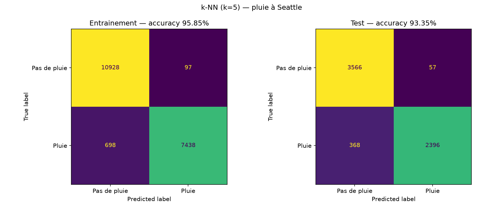

# KNN seatle rain
Implémentation de l'algo ML k-NN avec NumPy (scikit-learn sert au split et aux métriques) pour la classification d'un [dataset Kaggle](https://www.kaggle.com/datasets/rtatman/did-it-rain-in-seattle-19482017?resource=download) sur la météo à Seattle : prévoir les jours de pluie à l'aide d'une recherche k-NN avec k = 5.

Les résultats sont présentés dans une interface Streamlit (`app.py`) ; l'entrainement et la génération des rapports se font avec `train.py`.

## Lancer le projet
Deux méthodes de lancement : avec Docker (image publiée sur Docker Hub) ou en local avec uv. L'interface est ensuite disponible sur http://localhost:8501.

### 1. Avec Docker
Prérequis : `docker`

```sh
docker compose up -d            # récupère l'image n4ssim11/k-nn_seatle depuis Docker Hub
docker compose up -d --build    # ou reconstruit l'image localement
```

### 2. En local
Prérequis : `python 3.13+`, `uv`

`uv run` utilise automatiquement le `.venv`, il est donc inutile de l'activer (Linux, Mac et Windows) :

```sh
uv sync
uv run train.py               # (optionnel) ré-entraine et régénère graphiques et rapports
uv run streamlit run app.py
```

## Flux

1. Les données sont chargées et nettoyées avec pandas (lignes incomplètes supprimées, colonne `DATE` ignorée).
2. Le dataset est découpé en deux (75 % entrainement / 25 % test).
3. Chaque jour des deux splits est prédit par vote majoritaire de ses 5 plus proches voisins (distance euclidienne), toujours cherchés dans le split d'entrainement.
4. Des rapports évaluent les prédictions (précision, rappel, etc.), et les matrices de confusion sont regroupées dans un graphique : 

> ⚠️ Limites :
> - `RAIN` vaut `TRUE` exactement quand `PRCP > 0`. Garder `PRCP` comme feature constitue une fuite de données, donc les scores sont optimistes.
> - Les features ne sont pas normalisées : les températures pèsent beaucoup plus que `PRCP` dans la distance.
> - En entrainement, chaque point est son propre voisin (distance 0), donc le score d'entrainement est surestimé. Seul le score de test mesure la généralisation.

## Dictionnaire des données du [rapport test](data/graphs/rapport_test.txt) & [rapport entrainement](data/graphs/rapport_entrainement.txt)

| Terme | Signification |
| --- | --- |
| precision | vrais positifs / (vrais positifs + faux positifs) : part des prédictions d'une classe qui sont justes |
| recall | vrais positifs / (vrais positifs + faux négatifs) : part des vrais exemples d'une classe retrouvés |
| f1-score | 2 × (precision × recall) / (precision + recall) |
| support | nombre de vrais exemples de cette classe dans les données évaluées |
| accuracy | part de tous les jours correctement classés |
| macro avg | moyenne simple des métriques (precision, recall, f1) des deux classes |
| weighted avg | moyenne des métriques des deux classes, pondérée par le support |
